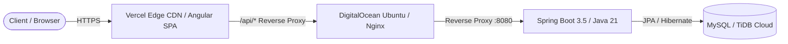

# 🏛️ Aadidev Properties

> **A modern, full-stack luxury real estate platform built with Angular, Spring Boot, and cloud-native architecture.**

[](https://angular.dev/)
[](https://spring.io/projects/spring-boot)
[](https://www.oracle.com/java/)
[](https://tailwindcss.com/)
[](https://www.mysql.com/)
[](https://vercel.com/)

---

## 🌟 Overview

**Aadidev Properties** is an end-to-end real estate solution designed to showcase premium residential and commercial properties (apartments, villas, plots, and offices). The platform delivers a seamless, high-performance user experience for buyers while providing administrators with a powerful control panel to manage listings, customer inquiries, and sales pipelines.

---

## ✨ Key Features

### 🏢 Public Marketplace
- **Curated Luxury Listings**: Browse featured apartments, villas, commercial hubs, and plots with high-resolution image galleries.
- **Dynamic Search & Filtering**: Instant multi-parameter filtering by property type, price range, location, and status (For Sale, For Rent, Sold Out).
- **Interactive Property Details**: Comprehensive property specifications, amenities checklist, and integrated location highlights.
- **Inquiry & Lead Capture**: Customers can submit direct inquiries, request call-backs, and book property viewings.

### 🛡️ Admin Control Panel
- **Role-Based Access Control (RBAC)**: Secure access restricted to authorized administrators via Spring Security.
- **Real-Time Analytics Dashboard**: Live metrics tracking total properties, featured listings, active inquiries, and status distribution.
- **Property Management (CRUD)**: Add, edit, remove, and upload multi-angle photos for any real estate listing.
- **Inquiry Pipeline**: Manage customer leads through custom pipeline stages (`NEW`, `CONTACTED`, `VISIT_SCHEDULED`, `CLOSED`).

### ⚡ Cloud Resilience & Automatic Wake-Up
- **Zero-Friction Cold Start**: Automatic backend health pinging (`/api/health`) on startup.
- **Smart Retry Engine**: If the cloud backend is sleeping or in standby, it auto-retries every 5 seconds for up to 90 seconds.
- **Luxury Connecting Screen**: Branded loading screen ("Connecting to Aadidev Properties") with live progress indicators.
- **Zero-Refresh Switch**: Automatically reveals live content the instant the backend is ready without requiring manual browser reload.

### 📊 Microsoft Clarity Analytics
- Integrated session recording and heatmap analytics injected dynamically at build time via environment configuration.

---

## 🏗️ Architecture & Tech Stack



| Layer | Technologies |
|---|---|
| **Frontend** | Angular 20, TypeScript, RxJS, Tailwind CSS, Angular Signals |
| **Backend** | Spring Boot 3.5.x, Java 21, Spring Data JPA, Spring Security |
| **Database** | MySQL / TiDB Cloud Serverless |
| **Deployment** | Vercel (Frontend), DigitalOcean Droplet + Nginx (Backend) |
| **Analytics** | Microsoft Clarity, Custom Real-IP Nginx Logger |

---

## 📁 Project Structure

```text
aadidevproperties/
├── backend/                             # Spring Boot Backend Application
│   ├── src/main/java/com/aadidevproperties/Office/
│   │   ├── controller/                  # REST Controllers (Auth, Property, Health, etc.)
│   │   ├── model/                       # JPA Entities (User, Property, Image, Inquiry)
│   │   ├── repository/                  # Spring Data JPA Repositories
│   │   ├── security/                    # Spring Security & Authentication Config
│   │   └── service/                     # Business Logic Services
│   ├── src/main/resources/
│   │   ├── application.yaml             # Core configuration
│   │   └── application-prod.yaml        # Production datasource & profiles
│   ├── build.gradle                     # Gradle dependencies & build configuration
│   └── gradlew                          # Gradle Wrapper script
│
├── frontend/                            # Angular 20 Single Page Application
│   ├── src/
│   │   ├── app/
│   │   │   ├── pages/                   # Home, Properties, Details, Admin, Auth
│   │   │   ├── service/                 # Property, Auth, Health, Toast, Clarity services
│   │   │   ├── shared/                  # Navbar, Footer, BackendConnecting, Toast
│   │   │   ├── model/                   # TypeScript interfaces and enums
│   │   │   ├── guard/                   # Admin authentication guard
│   │   │   └── interceptor/             # HTTP credential interceptor
│   │   ├── environments/                # Environment configurations (dev & prod)
│   │   └── styles.css                   # Global styles & luxury glassmorphism utilities
│   ├── angular.json                     # Angular workspace configuration
│   ├── package.json                     # Node dependencies & npm scripts
│   ├── set-env.js                       # Build-time environment variable injector
│   ├── tailwind.config.js               # Custom color palette & design tokens
│   └── vercel.json                      # Vercel deployment & API rewrite rules
│
└── .gitignore                           # Master repository gitignore
```

---

## 🚀 Getting Started

### Prerequisites
- **Java**: OpenJDK 21 or higher
- **Node.js**: v20.x or higher & npm
- **Database**: MySQL 8.x or TiDB Cloud instance
- **Git**: Installed and configured

---

### 1. Backend Setup

1. **Navigate to the backend directory:**
   ```bash
   cd backend
   ```

2. **Configure your Database:**
   Update your database credentials in `src/main/resources/application.yaml` or pass them via environment variables:
   ```yaml
   spring:
     datasource:
       url: jdbc:mysql://localhost:3306/aadidevbackend?createDatabaseIfNotExist=true
       username: YOUR_DB_USERNAME
       password: YOUR_DB_PASSWORD
   ```

3. **Build & Run the Backend:**
   ```bash
   # On Linux/macOS
   ./gradlew bootRun

   # On Windows (PowerShell)
   .\gradlew.bat bootRun
   ```

The backend server will start on `http://localhost:8080`. You can verify by visiting:
```bash
curl http://localhost:8080/api/health
```

---

### 2. Frontend Setup

1. **Navigate to the frontend directory:**
   ```bash
   cd frontend
   ```

2. **Install dependencies:**
   ```bash
   npm install
   ```

3. **Start the local development server:**
   ```bash
   npm start
   ```

Open your browser at `http://localhost:4200/`. The frontend is pre-configured with `proxy.conf.json` to proxy `/api` calls directly to `http://localhost:8080`.

---

## 📡 Core API Reference

| Method | Endpoint | Access | Description |
|---|---|---|---|
| `GET` | `/api/health` | Public | Lightweight system health & wake-up status ping |
| `GET` | `/api/properties` | Public | Retrieve all properties |
| `GET` | `/api/properties/featured` | Public | Retrieve featured showcase listings |
| `GET` | `/api/properties/{id}` | Public | Retrieve single property details |
| `GET` | `/api/images/{id}` | Public | Stream property image binary |
| `POST` | `/api/inquiries` | Public | Submit property inquiry / schedule visit |
| `POST` | `/api/auth/login` | Public | Authenticate user & issue session cookie |
| `POST` | `/api/auth/register` | Public | Register new user account |
| `GET` | `/api/dashboard/stats` | Admin | Real-time administrative metrics & lead pipeline |
| `POST` | `/api/properties` | Admin | Create a new property listing |
| `DELETE` | `/api/properties/{id}` | Admin | Delete property and related imagery |

---

## 🔒 Security & Privacy

- **Data Privacy**: All database dumps (`*.sql`), database schemas, and credentials are protected and excluded via `.gitignore`.
- **Session Protection**: HttpOnly cookies with `withCredentials: true` and CSRF protection.
- **Role Verification**: Admin routes are protected on both the frontend (`adminGuard`) and backend (`@PreAuthorize("hasRole('ADMIN')")`).

---

## 📄 License

Copyright © 2026 Aadidev Properties. All rights reserved.
Developed for **Aadidev Properties Luxury Real Estate**.
